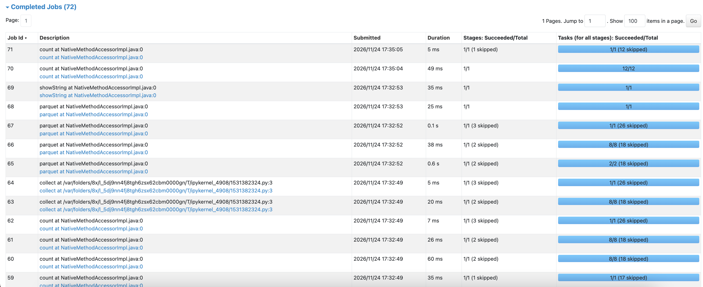
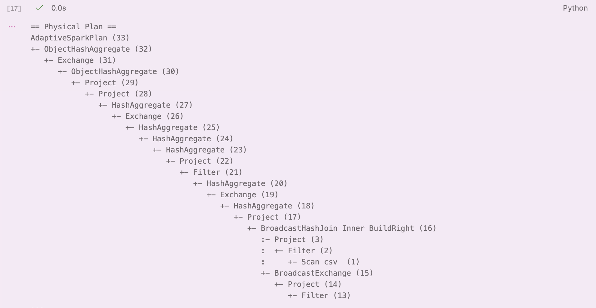
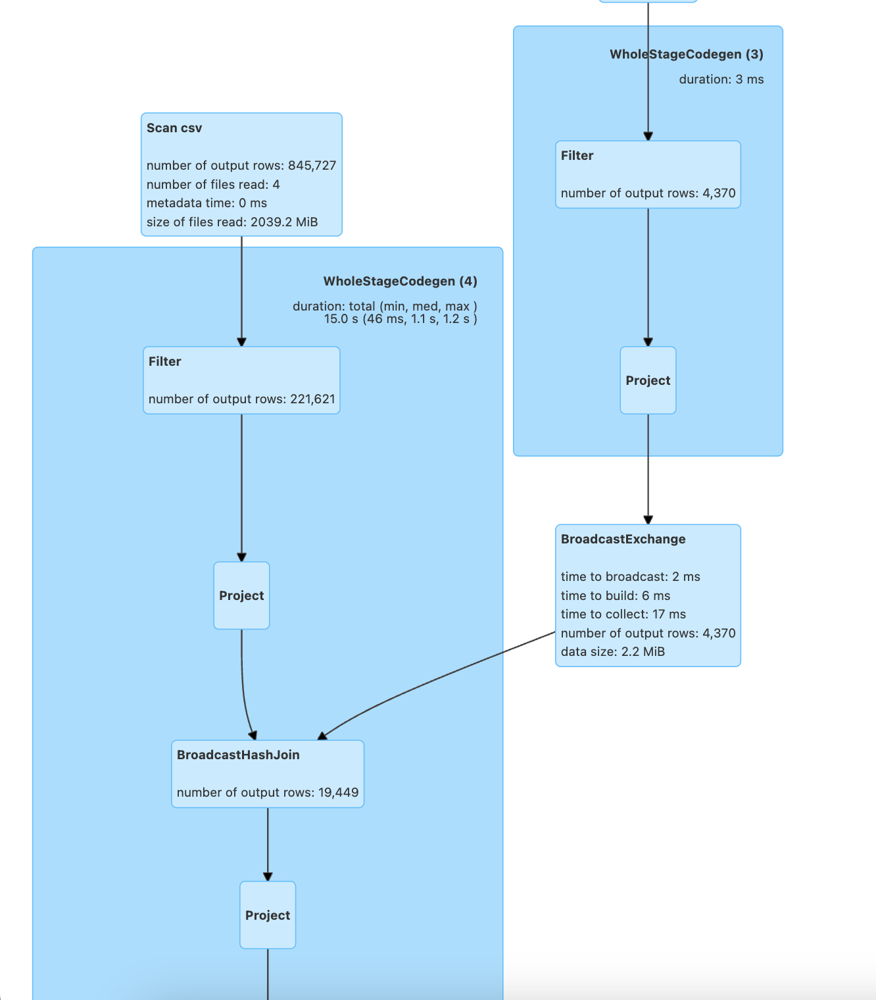

# Corporate Financial Performance Analysis with PySpark

## Project Overview

This project uses PySpark to process and analyze corporate financial statements from the U.S. Securities and Exchange Commission (SEC). The goal is to compare profitability and financial health across industries while demonstrating distributed data processing, lazy evaluation, and query optimization.

## Dataset

**Source:** [SEC Financial Statement Data Sets](https://www.sec.gov/dera/data/financial-statement-data-sets.html)

The dataset includes all four quarters of SEC filings submitted in 2025.

| Dataset                       |    Records |
| ----------------------------- | ---------: |
| Financial records (`num.txt`) | 14,621,539 |
| Filing records (`sub.txt`)    |     26,085 |
| Total raw data size           |     2.0 GB |

The numerical dataset contains reported financial metrics, while the submissions dataset contains company information, industry classifications, and filing metadata. The datasets are joined using the filing identifier (`adsh`).

The analysis focuses on annual 10-K filings from companies with U.S. business addresses. Fiscal year 2024 was selected because it had the largest number of annual filings in the dataset.

## Technologies

- Python 3.11
- PySpark 3.5.5
- Java 17
- Jupyter Notebook
- Spark SQL
- Apache Parquet
- Spark UI

## Data Processing Pipeline

1. Load all four quarterly datasets into Spark DataFrames.
2. Filter for annual filings and relevant financial metrics.
3. Remove segment-level and co-registrant financial records.
4. Select necessary columns and convert financial values to numerical data types.
5. Join financial records with company metadata using a broadcast join.
6. Calculate financial ratios using `withColumn()`.
7. Aggregate financial metrics by industry using `groupBy()`.
8. Execute Spark SQL queries to compare profitability and financial leverage.
9. Write processed results to Parquet files.

### Financial Metrics

The pipeline calculates three financial ratios:

| Metric                        | Calculation                              |
| ----------------------------- | ---------------------------------------- |
| Net profit margin             | Net income / Revenue × 100               |
| Liabilities-to-assets ratio   | Total liabilities / Total assets         |
| Return on assets (simplified) | Net income / Year-end total assets × 100 |

## Key Findings

The analysis uses two Spark SQL queries to identify industries with the highest median profit margins and liabilities-to-assets ratios. Each query requires at least 10 companies with valid observations for the relevant metric.

- Depository institutions had the highest median profit margin at **28.01%**, followed by securities and commodity brokers at **16.73%**.
- Electric, gas, and sanitary services had a median profit margin of **11.79%**.
- Depository institutions also had the highest median liabilities-to-assets ratio at **89.76%**.
- The chemicals and allied products industry had a median profit margin of approximately **−110.04%**.
- A total of **1,434 companies** had positive profit margins.

Financial reporting conventions and capital structures differ across industries. These findings reflect companies with available financial metrics and should not be interpreted as representative of every company in an industry.

## Performance Analysis

Spark optimized the pipeline through predicate pushdown, column pruning, and broadcast joins. The physical execution plan showed `PushedFilters` for financial tags, currency, reporting duration, and other conditions. Column pruning reduced the number of fields read and processed, while early filtering reduced the numerical dataset from approximately 14.6 million records to 221,621 records before the join, a reduction of approximately 98.48%. Because the source files were CSV-based, predicate pushdown did not eliminate the need to scan the underlying files.

The execution plan also demonstrated a `BroadcastHashJoin`. Spark broadcasted 4,370 filing records totaling 2.2 MiB, avoiding the need to shuffle both datasets for the join. The join produced 19,449 matching financial records. The primary remaining performance costs were scanning approximately 2 GB of source data and shuffling records during grouped aggregations, as indicated by the `Exchange` operators. The observed hash aggregation reported zero disk spill.

The pipeline used eight initial shuffle partitions for local processing and Adaptive Query Execution to support runtime optimization. Processed company records were written to Parquet partitioned by fiscal year, while the smaller industry summary was consolidated to avoid unnecessary small files. Since the analysis covers only one fiscal year, the performance benefits of year-based partitioning were not directly measured.

## Actions vs. Transformations

Spark uses lazy evaluation, meaning transformations construct an execution plan without immediately processing the data. Actions trigger the execution of that plan.

The experiment compared defining a filter and column selection with executing a `count()` action.

| Operation                           | Execution Time |
| ----------------------------------- | -------------: |
| Transformation (`filter`, `select`) | 0.0114 seconds |
| Action (`count`)                    | 1.8282 seconds |

The transformation took significantly less time because Spark deferred computation until the action was called.

## Caching Optimization

An additional experiment compared the execution time of the same aggregation before and after caching the company-level DataFrame.

| Operation             | Execution Time |
| --------------------- | -------------: |
| Uncached aggregation  |  1.794 seconds |
| Cache materialization |  1.826 seconds |
| Cached aggregation    |  0.058 seconds |

The cached aggregation achieved an observed **30.9× speedup**, representing a **96.8% reduction in execution time**. Although caching introduces an initial materialization cost, it can improve performance when the same DataFrame is accessed repeatedly. Actual performance may vary depending on available memory, JVM warmup, and operating-system caching.

## Screenshots

### Successful Pipeline Execution

The Spark UI shows 72 completed jobs, including aggregation and Parquet operations.

### Physical Execution Plan

The physical execution plan demonstrates adaptive query execution, filtering, broadcast joins, and aggregation.

### Query Details and Optimization

The Spark SQL execution graph shows filtering, broadcasting, joining, and aggregation alongside execution metrics.

## Running the Project

1. Install Python 3.11 and Java 17.
2. Install the required Python dependencies:

   `pip install -r requirements.txt`

3. Download the four quarterly SEC datasets for 2025.
4. Extract `num.txt` and `sub.txt` into their corresponding directories under `data/raw/`.
5. Open the financial analysis notebook and run all cells.
6. Access the Spark UI using the URL returned by `spark.sparkContext.uiWebUrl`.

## Output

The pipeline generates two Parquet datasets:

- `data/processed/companies/` — Company-level financial metrics.
- `data/processed/industry_summary/` — Aggregated industry-level financial metrics.

Raw and processed datasets are excluded from the GitHub repository due to their size.
